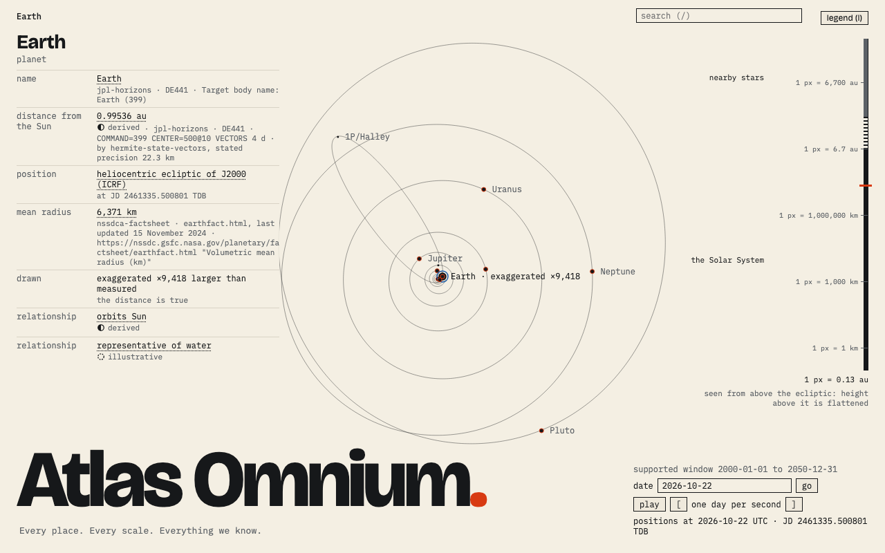
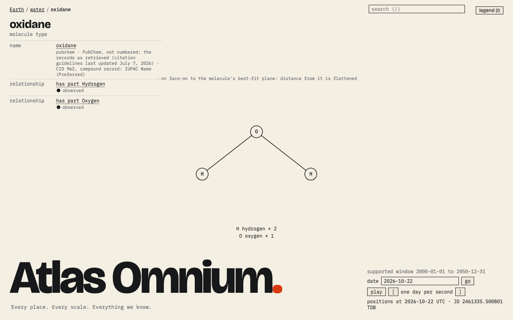

# Atlas Omnium.

**Every place. Every scale. Everything we know.**

An explorable, connected representation of physical reality as humanity currently understands it:
real entities, actual observed places, their structure, motion and relationships, travelled
outwards through astronomical scales and inwards through physical composition. Not another scale
animation and not an encyclopedia: a place where selecting a thing and following its relationships
is the interface, and where every view says whether it is measured, inferred, schematic or
illustrative.

The brief is `atlas-omnium-product-spec.md` (v0.1, 22 October 2026). The design documents
under `docs/` restate it as the contracts the code is held to; where they disagree with the brief,
the documents win and say why in `decisions/`.

## Two scales of 001

*The Solar System, about 0.13 au to the pixel. Positions come from JPL Horizons for the date shown;
Earth is drawn larger than measured, and the label says by how much.*

*What Earth is made of, a different kind of step: the water molecule from PubChem's conformer of
CID 962, in the molecule's own frame, with each atom type and its count.*

These are the visual tier's approved baselines, so they change when the screen does.

## Status

The first feature, **001 earth**, is built and in review. It is the vertical slice the brief calls
for: Earth, the Solar System under real time-dependent positions, a bounded
nearby-star sample, the orbit-to-stars transition that keeps the Sun's identity, and one explicitly
structural path from Earth to water to its atoms. It is specified and built with spec-kit under
`specs/001-earth/`; the tick count in its `tasks.md` is the status.

## Layout

| Path | Holds |
|---|---|
| `app/` | the browser application: `index.html` and `src/` (`model`, `navigation`, `projections`, `renderers`, `ui`) |
| `data/manifests/` | one manifest per atlas release: sources, queries, retrieval times, checksums |
| `data/curated/` | the validated snapshots the application loads; `data/raw/` the responses they were built from |
| `ingest/` | the scripts that acquire, validate and freeze a snapshot; never called by the browser |
| `tests/` | `scientific`, `navigation`, `visual` suites and their `fixtures` |
| `docs/` | `vision.md`, `data-contracts.md`, `rendering.md`, `evaluation.md` |
| `decisions/` | why things are shaped as they are, one dated record each |
| `features/`, `GLOSSARY.md` | the living Gherkin features and the one sense of every word they use |
| `specs/` | spec-kit features: spec, plan, research, data model, contracts, tasks |

## Running

Node 24 or later. Everything works without `just`; the Justfile lists the same commands.

| What | Command |
|---|---|
| Install exactly as locked | `npm ci` |
| Dev server with hot reload | `npm run dev` |
| Type-check and build into `dist/` | `npm run build` |
| The unit, scientific and navigation suites | `npm test` |
| The living features, glossary and specs | `just check` |
| Rebuild the release offline and check its checksums | `just rebuild` |
| The living features end to end in a browser | `npm run features` |
| Screenshots against the approved baselines | `npm run visual` |
| Frame times, load time and heap growth | `npm run perf` |
| Acquire the snapshots again (needs the network) | `just ingest` |
| Derive the shared-names test release | `just test-release` |

## Principles the code is held to

Ten, from the brief, in `docs/vision.md`. The ones that decide most requirements: reality first,
the universe is the interface, show the limits of knowledge, time matters, traceable claims. No
factual value is ever invented to fill a gap; a missing value stays missing and is shown as such.
